# BÁO CÁO BÀI TẬP

## THÔNG TIN SINH VIÊN
- **Họ và tên:** Phạm Hữu hưng
- **Mã số sinh viên:** 24810310239
- **Lớp:** D19CNPM3
- **Tên môn học:** Lập trình .NET
- **Tên bài tập:** Ôn tập Window Form

---

## KẾT QUẢ THỰC HÀNH

### Bài 1: Máy tính tính cước dịch vụ & Giảm giá (Service Charge Calculator)

#### ẢNH GIAO DIỆN MÀN HÌNH CHÍNH

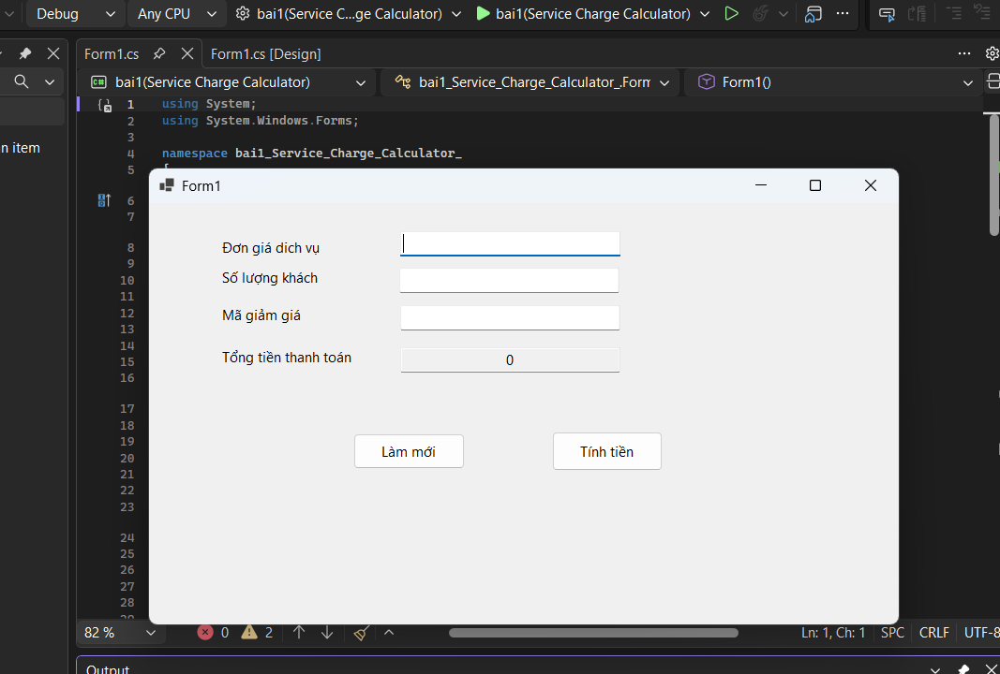

##### ẢNH MÀN HÌNH THỰC THI

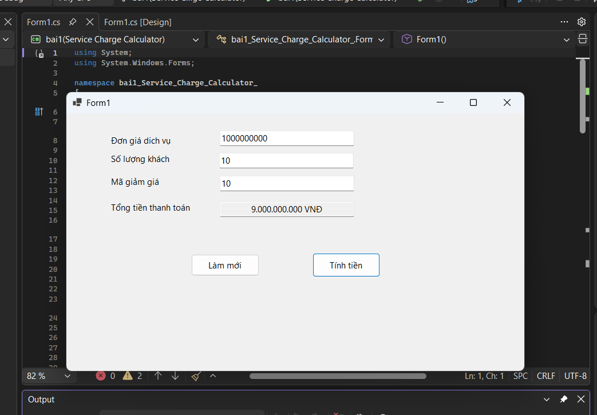

#### ẢNH MÀN HÌNH KIỂM TRA LỖI

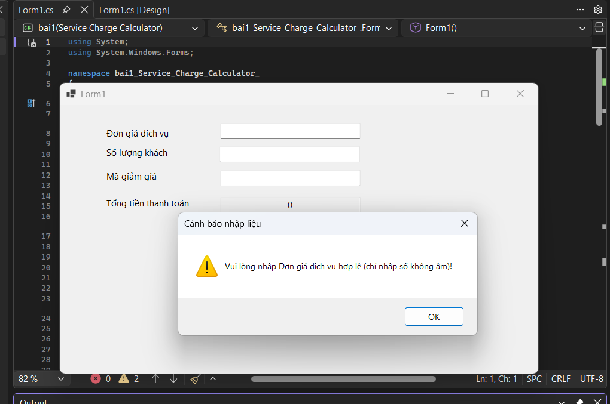

---

### Bài 2: Form Tiếp nhận & Phân loại sự cố IT (IT Support Ticket Form)

#### ẢNH GIAO DIỆN MÀN HÌNH CHÍNH

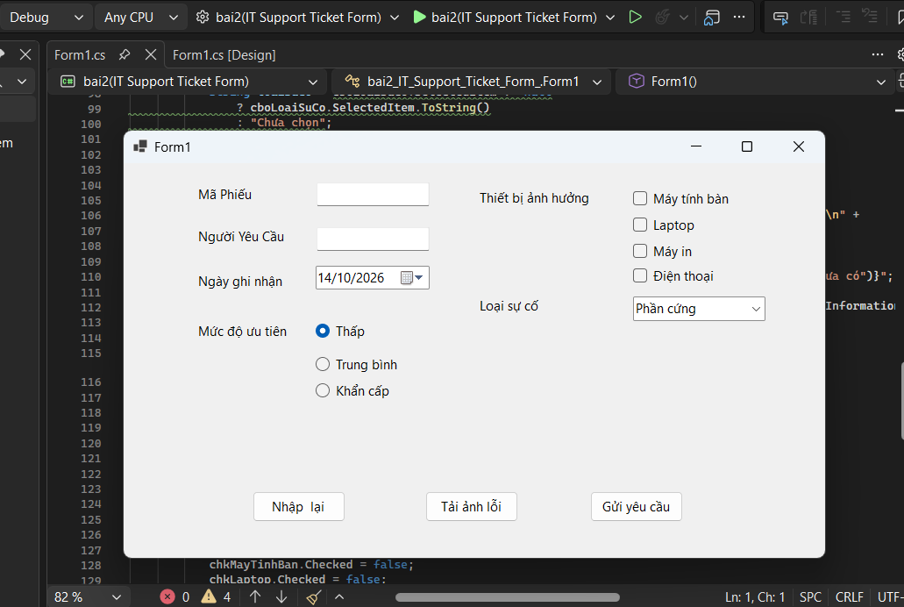

##### ẢNH MÀN HÌNH THỰC THI

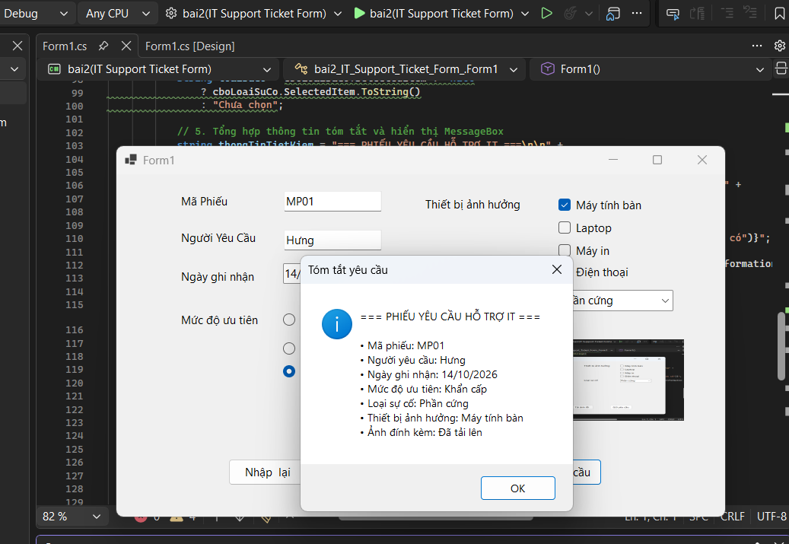

#### ẢNH MÀN HÌNH KIỂM TRA LỖI

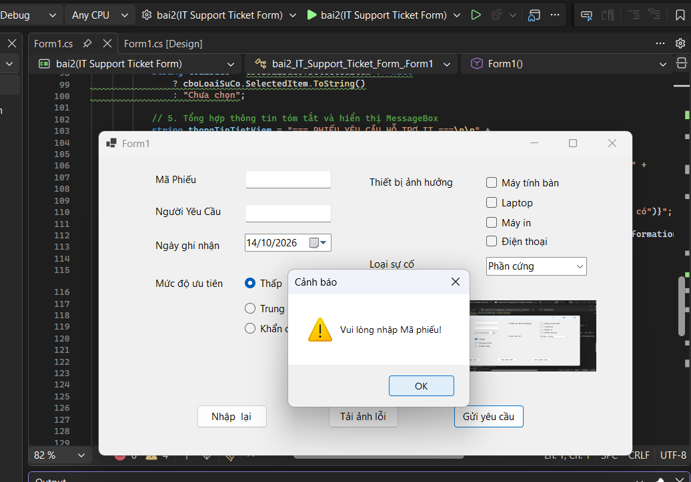

---

### Bài 3: Quản lý danh mục Vật tư / Linh kiện (Item List Manager)

#### ẢNH GIAO DIỆN MÀN HÌNH CHÍNH

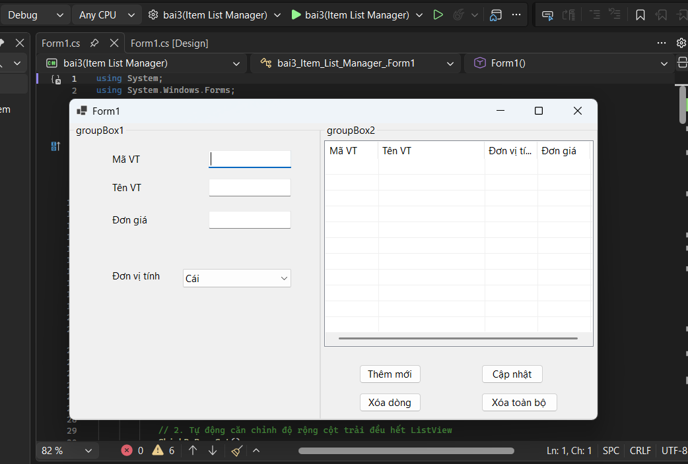

##### ẢNH MÀN HÌNH THỰC THI

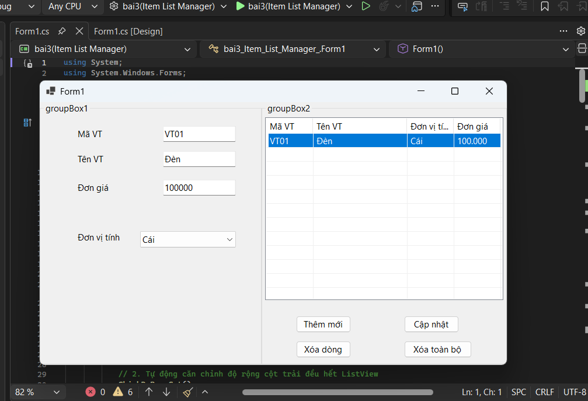

#### ẢNH MÀN HÌNH KIỂM TRA LỖI

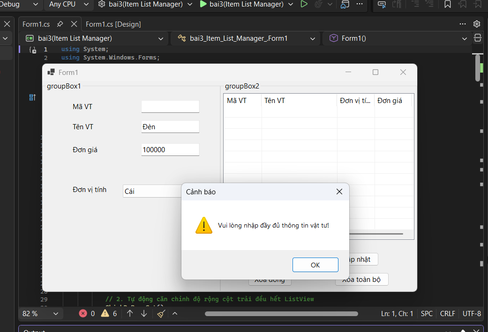

---

### Bài 4: Sơ đồ chọn vị trí chỗ ngồi / Đặt bàn hẹn giờ (Interactive Slot Booking)

#### ẢNH GIAO DIỆN MÀN HÌNH CHÍNH

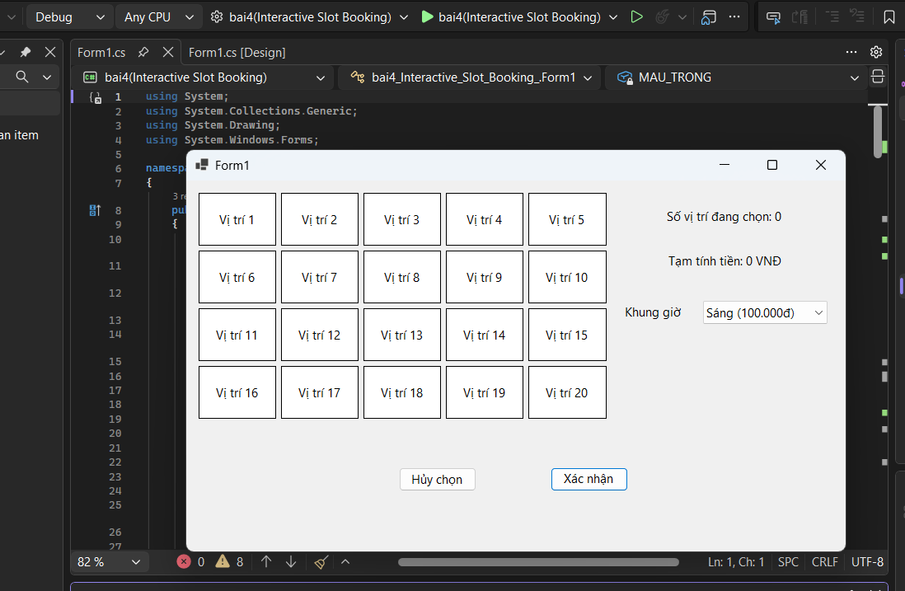

##### ẢNH MÀN HÌNH THỰC THI

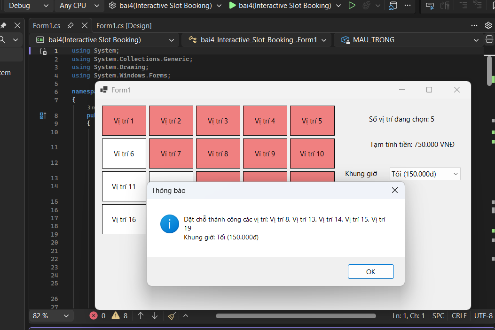

#### ẢNH MÀN HÌNH KIỂM TRA LỖI

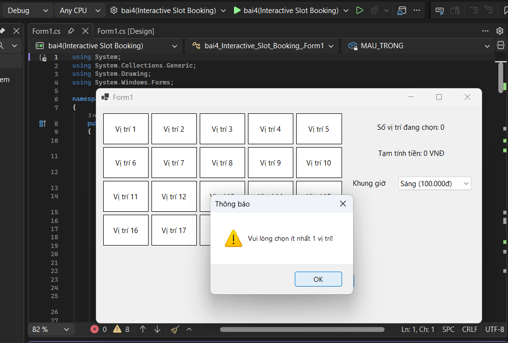

---

### Bài 5: Bảng điều khiển Quản lý Đơn giao hàng (Delivery Order Dashboard)

#### ẢNH GIAO DIỆN MÀN HÌNH CHÍNH

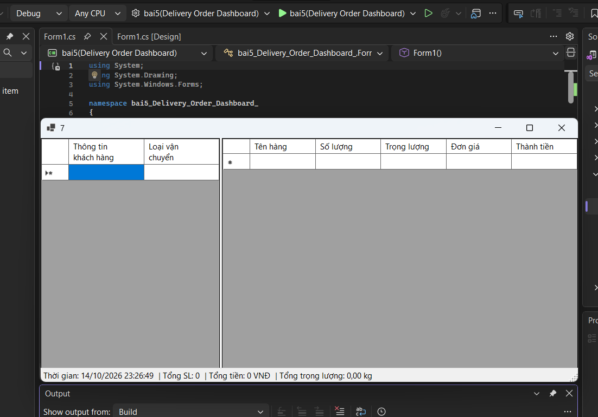

##### ẢNH MÀN HÌNH THỰC THI

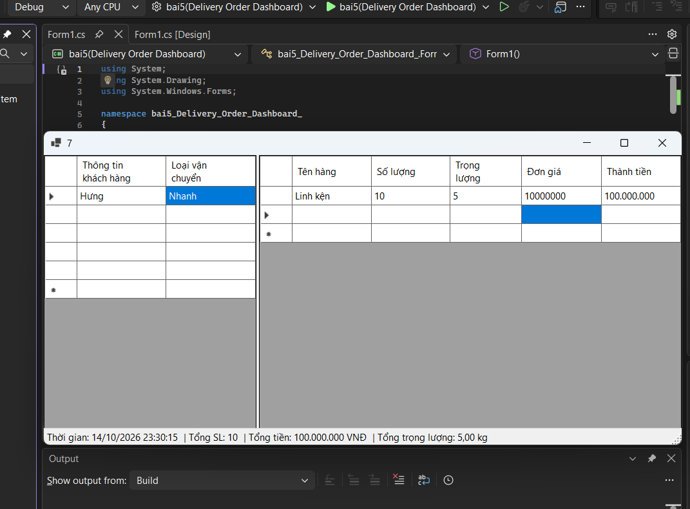

#### ẢNH MÀN HÌNH KIỂM TRA LỖI

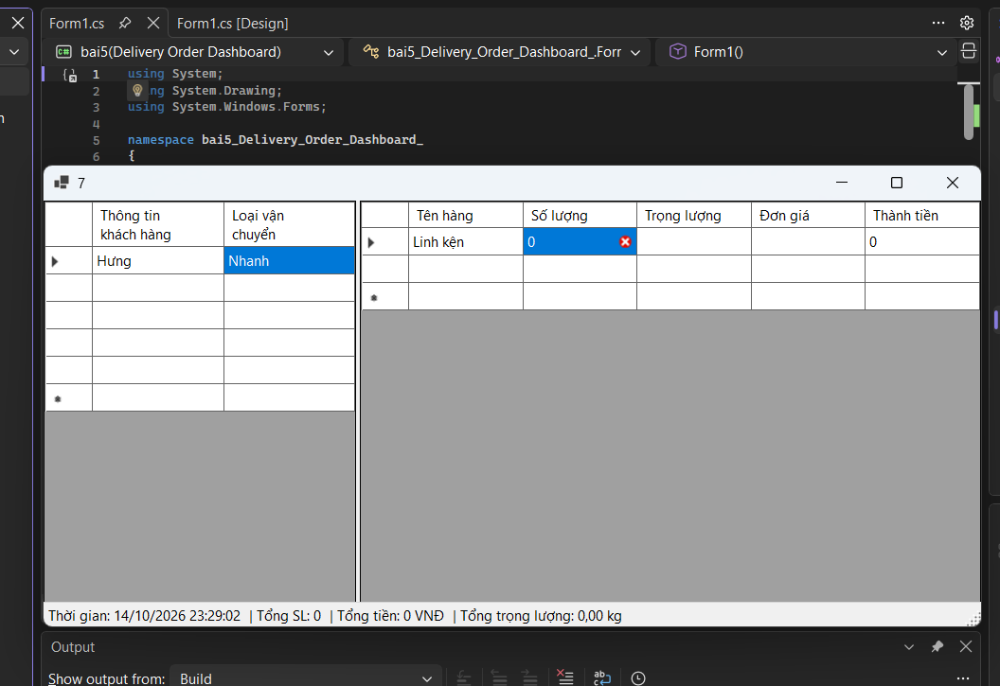

---

